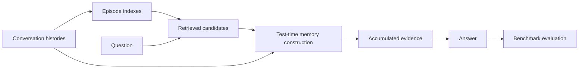

<div align="center">

# T2Mem: Test-Time Memory Construction

[](https://github.com/OpenBMB/T2Mem)
[](environment.yml)
[](LICENSE)

Experiment code for **Test-Time Memory Construction**.

[Introduction](#introduction) · [Setup](#setup) · [Reproduction](#reproduction) · [Evaluation](#evaluation) · [Structure](#structure)

</div>

<a id="introduction"></a>

## 📖 Introduction

**T2Mem** constructs query-relevant memory at inference time from long conversation histories. It first builds lightweight episode indexes. Given a question and retrieved candidate episodes, a controller iteratively reads indexes, recovers raw sessions, and accumulates evidence. A separate answer stage generates the final response from that evidence.

This repository contains the preprocessing, episode indexing, retrieval, test-time construction, and LLM-judge evaluation pipelines for **LoCoMo** and **LongMemEval**, including structured-index, summary-index, and reading-mode ablations.



<a id="setup"></a>

## ⚙️ Setup

### 1. Install

```bash
git clone https://github.com/OpenBMB/T2Mem.git
cd T2Mem

# Conda (Python 3.10)
bash scripts/setup_env.sh
conda activate t2mem
```

Alternatively, use a virtual environment with Python 3.10 or newer:

```bash
python -m venv .venv
source .venv/bin/activate
python -m pip install -r requirements.txt
```

Episode indexing, inference, and evaluation call OpenAI-compatible APIs. Retrieval supports API and local embeddings for every representation on both benchmarks. Install the optional local backend when needed:

```bash
python -m pip install -r requirements-local.txt
```

Local embeddings require a sentence-transformers model and install PyTorch. The LLM stages do not load local model weights.

### 2. Configure endpoints once

```bash
cp .env.example .env
# Fill in the LLM, embedding, and judge settings in .env.
```

[`run.py`](run.py) automatically loads the repository's `.env`. The precedence is **CLI options → existing environment variables → `.env` → defaults**. Keys are kept out of Git. No `source` command is needed for the unified entry point.

| Setting | Purpose |
|---|---|
| `T2MEM_LLM_BASE_URL`, `T2MEM_LLM_MODEL_NAME`, `T2MEM_LLM_API_KEY` | Episode indexing and inference |
| `T2MEM_CONTROLLER_MODEL_NAME`, `T2MEM_ANSWER_MODEL_NAME` | Optional separate models on the same LLM endpoint |
| `T2MEM_EMBEDDING_BASE_URL`, `T2MEM_EMBEDDING_MODEL_NAME`, `T2MEM_EMBEDDING_API_KEY` | API embeddings for both benchmarks and every representation |
| `EMBED_BACKEND` | `api` (default in `run.py`) or `local` |
| `T2MEM_EMBEDDING_MODEL` | Local embedding model path or model ID |
| `JUDGE_BASE_URL`, `JUDGE_API_KEY`, `JUDGE_MODEL` | LLM-judge evaluation |

With API embeddings, both benchmarks need only `requirements.txt`; there is no local LLM or PyTorch requirement. Choose the local embedding backend and install `requirements-local.txt` when needed.

<a id="reproduction"></a>

## 🔧 Reproduction Guide

### 1. Put the raw datasets in `data/`

```text
data/
├── locomo10.json                 # LoCoMo
└── longmemeval_s_cleaned.json     # LongMemEval
```

Either or both files may be present. Download them from [LoCoMo](https://github.com/snap-research/locomo) and [LongMemEval](https://github.com/xiaowu0162/LongMemEval); commands and schemas are in [data/README.md](data/README.md). The previous `data/raw/` location is also supported. Datasets and generated artifacts stay out of Git.

### 2. Run with one command

```bash
python run.py --check   # Validate inputs/configuration; no model calls.
python run.py           # Discover available datasets and run all five stages.
```

The full pipeline runs **preprocess → index → retrieve → infer → evaluate**. To select a benchmark or omit evaluation:

```bash
python run.py locomo
python run.py longmemeval
python run.py locomo --skip-eval
```

A full run requires LLM, embedding, and judge configuration. `--skip-eval` requires only the LLM and embedding configuration. The entry point checks configuration and dependencies before starting, then verifies each stage's artifacts. Failed or missing rows stop the pipeline with a nonzero exit status and an artifact/log path.

Raw input files are read only. Processed data, indexes, retrieval files, logs, and prediction/evaluation directories are created automatically. Repeating a stage replaces its generated output; existing files are not silently reused.

### 3. Run individual stages

```bash
python run.py locomo --stage preprocess
python run.py locomo --stage index
python run.py locomo --stage retrieve
python run.py locomo --stage infer
python run.py locomo --stage evaluate
```

Use `longmemeval` for the other benchmark. Each stage checks its required inputs, so no manual file-path wiring is needed. For a custom filename, use `--data-path` when preprocessing:

```bash
python run.py longmemeval --stage preprocess --data-path data/my_longmemeval.json
```

For an existing prediction file:

```bash
python run.py locomo --stage evaluate --predictions outputs/my_run.jsonl
```

### 4. Change experiment settings

```bash
# Query subset before a full run; indexes/retrieval still cover the full dataset.
python run.py locomo --limit 5

# Independent candidate and initial-observation counts.
python run.py locomo --retrieval-top-k 10 --top-k 5

# Reading-mode ablations; matching retrieval is selected automatically.
python run.py locomo --read-mode wiki-only
python run.py locomo --read-mode raw-only

# Summary-index ablation, including matching retrieval.
python run.py longmemeval --variant summary

# Local embeddings (optional requirements-local.txt).
python run.py longmemeval --embed-backend local

# Structured LoCoMo controller budget and prompt analysis.
python run.py locomo --output-budget-tokens 400 --dump-prompts
```

`--limit` applies to inference and evaluation, not session indexing or retrieval. Budget, reasoning-budget, and prompt-dump options are available only for structured LoCoMo. Summary readers support `full` mode only. Run `python run.py --help` for all options or see [docs/experiments.md](docs/experiments.md).

The default prediction paths remain:

```text
outputs/locomo_structured_t2mem_full_answers.jsonl
outputs/longmemeval_structured_t2mem_full_answers.jsonl
```

Rows contain query metadata, controller traces, accumulated evidence, and `prediction`. Structured LoCoMo also writes a `*_token_usage_summary.json`. The separate answer stage and original benchmark prompts are retained.

<a id="evaluation"></a>

## 📊 Evaluation

The unified runner evaluates predictions as its final stage. To evaluate separately with credentials loaded from `.env`:

```bash
python run.py locomo --stage evaluate

python run.py longmemeval --stage evaluate
```

Evaluation writes per-query judgments and an accuracy summary under `eval-results/`. The LoCoMo runner converts JSONL predictions into the judge's conversation-keyed input. LoCoMo category 5 is excluded, as in the supplied experiment code. Failed prediction rows are retained as empty responses rather than silently removed.

Judge failures and invalid responses must be checked before interpreting accuracy; the unified runner reports them as stage failures. LoCoMo overall accuracy excludes judge errors, while LongMemEval includes submitted rows in its denominator. This repository does not bundle paper result tables or claim that the offline checks reproduce model accuracy. The evaluation conventions are documented in [docs/experiments.md](docs/experiments.md#evaluation-conventions).

<a id="structure"></a>

## 📁 Repository Structure

```text
T2Mem/
├── README.md
├── LICENSE                       MIT license
├── run.py                        One-command and staged experiment entry point
├── .env.example                  Endpoint and model configuration template
├── environment.yml               Conda environment
├── requirements.txt              API pipeline dependencies
├── requirements-local.txt        Optional local embedding dependencies
├── scripts/                      Preprocessing, indexing, retrieval, inference, evaluation
├── src/
│   ├── common/                   Pipeline orchestration and embedding backends
│   ├── locomo/
│   │   ├── t2mem/                Controller loop and answer entry points
│   │   ├── prompt/               Indexing, controller, and answer prompts
│   │   ├── wiki/                 Preprocessing and episode indexing
│   │   ├── retrieval/            Candidate retrieval
│   │   └── utils/                Dataset reader, API client, config, index repair
│   └── longmemeval/               Same stages for LongMemEval
├── evaluation/                   Judges and LoCoMo prediction adapter
├── data/README.md                Benchmark acquisition and schemas
├── docs/experiments.md           Settings, outputs, and evaluation conventions
├── CONTRIBUTING.md              Development and commit conventions
└── tests/                        Offline integration tests
```

The benchmark implementations run as separate CLI processes and retain their dataset-specific prompts and behavior. They are not an installable shared Python package.

## 🧪 Development Checks

```bash
python -m unittest discover -s tests -v
python -m compileall -q run.py src evaluation tests
```

Tests exercise automatic dataset discovery, `.env` loading, full and individual stages, all API retrieval representations, optional local embeddings, structured reading modes, controller actions, budget fallback, evaluation, and CLI imports. A local mock API and deterministic embedding stub replace external models; no benchmark download or paid API call is required. GitHub Actions runs these checks on Python 3.10 and 3.12.

## 🙏 Acknowledgements

We thank the authors of [LoCoMo](https://github.com/snap-research/locomo) and [LongMemEval](https://github.com/xiaowu0162/LongMemEval) for their benchmarks. Repository presentation follows the research-code organization of [MetaMem](https://github.com/OpenBMB/MetaMem) and [ParamMute](https://github.com/OpenBMB/ParamMute).

## 📄 License

The code is distributed under the [MIT License](LICENSE). Benchmark data and pretrained models remain subject to their upstream terms.
