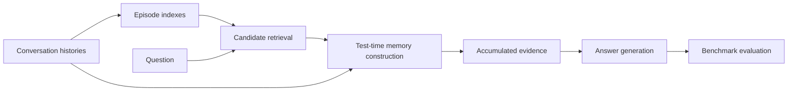

<div align="center">

# T2Mem: Test-Time Memory Construction

Code and experiments for **Test-Time Memory Construction**.

[](https://github.com/OpenBMB/T2Mem)
[](requirements.txt)
[](LICENSE)
[](https://github.com/snap-research/locomo)
[](https://github.com/xiaowu0162/LongMemEval)

[Overview](#overview) · [Installation](#installation) · [Data](#data) · [Experiments](#experiments) · [Evaluation](#evaluation) · [Outputs](#outputs)

</div>

## Overview

**T2Mem** constructs query-relevant memory at test time from long conversation histories. Episode indexes provide lightweight descriptions of conversation sessions. Given a question, a controller iteratively searches candidate episodes, reads session content, and accumulates evidence for a separate answer-generation stage.

Experiments cover **LoCoMo** and **LongMemEval**, with structured episode indexes, summary indexes, and reading-mode ablations.



## Installation

Python **3.10 or newer** is required.

```bash
git clone https://github.com/OpenBMB/T2Mem.git
cd T2Mem
python -m venv .venv
source .venv/bin/activate
python -m pip install -r requirements.txt
```

For Conda:

```bash
bash scripts/setup_env.sh
conda activate t2mem
```

Index construction, memory construction, answer generation, and evaluation use OpenAI-compatible APIs. API embeddings are supported for both benchmarks and all index representations. For local sentence-transformers embeddings, install the optional dependencies:

```bash
python -m pip install -r requirements-local.txt
```

### Model configuration

```bash
cp .env.example .env
```

Set the endpoints, served model names, and API keys in `.env` using the [configuration template](.env.example). [`run.py`](run.py) loads this file automatically. CLI options override environment settings; existing environment variables override `.env` values.

| Configuration | Purpose |
|---|---|
| `T2MEM_LLM_BASE_URL`, `T2MEM_LLM_MODEL_NAME`, `T2MEM_LLM_API_KEY` | Index construction, controller, and answer generation |
| `T2MEM_CONTROLLER_MODEL_NAME`, `T2MEM_ANSWER_MODEL_NAME` | Optional separate controller and answer models on the LLM endpoint |
| `T2MEM_EMBEDDING_BASE_URL`, `T2MEM_EMBEDDING_MODEL_NAME`, `T2MEM_EMBEDDING_API_KEY` | API embeddings |
| `EMBED_BACKEND` | `api` (default) or `local` |
| `T2MEM_EMBEDDING_MODEL` | Local embedding model path or model ID |
| `JUDGE_BASE_URL`, `JUDGE_API_KEY`, `JUDGE_MODEL` | Evaluation judge |

The full pipeline requires LLM, embedding, and judge configuration. Use `--skip-eval` to run through answer generation without a judge.

## Data

Download the raw benchmark files from their official releases and place either or both in `data/`:

| Benchmark | Dataset | Filename |
|---|---|---|
| LoCoMo | [Official data](https://github.com/snap-research/locomo/tree/main/data) | `locomo10.json` |
| LongMemEval | [Cleaned dataset](https://huggingface.co/datasets/xiaowu0162/longmemeval-cleaned) | `longmemeval_s_cleaned.json` |

```text
data/
├── locomo10.json
└── longmemeval_s_cleaned.json
```

Files in `data/raw/` are also recognized. LongMemEval additionally supports `longmemeval_m_cleaned.json` and `longmemeval_oracle.json`. If multiple files match the same benchmark, select one with `--data-path`. Download commands and data schemas are documented in [data/README.md](data/README.md).

## Experiments

### End-to-end reproduction

Validate the configuration and inputs, then run all datasets found in `data/`:

```bash
python run.py --check
python run.py
```

The pipeline executes **preprocessing → index construction → retrieval → memory construction and answer generation → evaluation**. Select a benchmark explicitly with:

```bash
python run.py locomo
python run.py longmemeval
```

To generate predictions without evaluation:

```bash
python run.py locomo --skip-eval
```

Raw datasets are read only. Each stage creates its output directory and verifies its artifacts. Repeating a stage overwrites its generated files. Failed stages return a nonzero exit status and report the artifact or log path.

### Stage-by-stage execution

```bash
python run.py locomo --stage preprocess
python run.py locomo --stage index
python run.py locomo --stage retrieve
python run.py locomo --stage infer
python run.py locomo --stage evaluate
```

Replace `locomo` with `longmemeval` for LongMemEval. Intermediate files are selected automatically. Use the same variant and reading mode across all stages.

For a dataset with a custom filename:

```bash
python run.py longmemeval --stage preprocess --data-path data/my_longmemeval.json
```

### Ablations

| Setting | Option | Scope |
|---|---|---|
| Structured episode indexes | `--variant structured` | Both benchmarks; default |
| Summary indexes | `--variant summary` | Both benchmarks; `full` reading mode |
| Index and raw-session reading | `--read-mode full` | Structured indexes; default |
| Index-only reading | `--read-mode wiki-only` | Structured indexes |
| Raw-session reading | `--read-mode raw-only` | Structured indexes |
| Controller output budget | `--output-budget-tokens` | Structured LoCoMo |
| Controller reasoning budget | `--reasoning-budget` | Structured LoCoMo |

```bash
python run.py locomo --read-mode wiki-only
python run.py locomo --read-mode raw-only
python run.py longmemeval --variant summary
python run.py locomo --output-budget-tokens 400 --dump-prompts
```

The reading-mode experiments select the matching retrieval representation. `raw-only` also requires the structured index file.

### Reproduction parameters

| Option | Default | Description |
|---|---|---|
| `--retrieval-top-k` | `10` | Ranked candidates per question |
| `--top-k` | `5` | Candidates in the initial controller observation |
| `--max-steps` | `5` | Maximum controller rounds |
| `--workers` | `8` | Concurrent indexing, inference, or judge requests |
| `--embed-backend` | `api` | API or local embeddings |
| `--limit` | All questions | Query limit for inference and evaluation |

```bash
python run.py locomo --retrieval-top-k 10 --top-k 5 --max-steps 5
python run.py longmemeval --embed-backend local
python run.py locomo --limit 5
```

`--limit` does not restrict index construction or retrieval. Record the dataset version, model versions, embedding backend, judge configuration, and experiment parameters alongside reported results. Full parameter details and budget semantics are in [docs/experiments.md](docs/experiments.md).

## Evaluation

Evaluation is the final pipeline stage. To evaluate existing predictions:

```bash
python run.py locomo --stage evaluate
python run.py longmemeval --stage evaluate

# Evaluate a specified prediction file.
python run.py locomo --stage evaluate --predictions outputs/my_run.jsonl
```

Judgments and accuracy summaries are written to `eval-results/`.

- **LoCoMo:** category 5 is excluded. JSONL predictions are converted into conversation-keyed judge inputs. Failed predictions are evaluated as empty responses. Overall accuracy is computed over successful judge responses.
- **LongMemEval:** evaluation uses task-specific judge prompts and abstention handling. The accuracy denominator includes submitted rows, including invalid or failed judgments.

Inspect error counts and invalid judgments before reporting accuracy. The pipeline treats judge errors and invalid responses as stage failures. Evaluation conventions are detailed in [docs/experiments.md](docs/experiments.md#evaluation-conventions).

## Outputs

| Location | Contents |
|---|---|
| `data/<dataset>_processed.json` | Processed sessions and question metadata |
| `data/<dataset>/` | Episode indexes and ranked retrieval candidates |
| `outputs/` | Predictions, controller traces, and accumulated evidence |
| `eval-results/` | Per-question judgments and accuracy summaries |

Default prediction filenames:

```text
outputs/locomo_structured_t2mem_full_answers.jsonl
outputs/longmemeval_structured_t2mem_full_answers.jsonl
```

Structured LoCoMo additionally produces a `*_token_usage_summary.json`. Use `--data-dir`, `--output-dir`, and `--eval-dir` to select separate directories for experiment runs. Logs are stored alongside stage outputs.

## Repository structure

```text
T2Mem/
├── run.py                        Full-pipeline and individual-stage entry point
├── .env.example                  API and model configuration
├── requirements.txt              API experiment dependencies
├── requirements-local.txt        Optional local embedding dependencies
├── environment.yml               Conda environment
├── src/
│   ├── common/                   Pipeline orchestration and embedding backends
│   ├── locomo/                   LoCoMo prompts, indexes, retrieval, and readers
│   └── longmemeval/               LongMemEval prompts, indexes, retrieval, and readers
├── scripts/                      Individual-stage shell entry points
├── evaluation/                   Benchmark judges and prediction adapter
├── data/README.md                Dataset acquisition and schemas
└── docs/experiments.md           Detailed experimental settings
```

## Acknowledgements

We thank the authors of [LoCoMo](https://github.com/snap-research/locomo) and [LongMemEval](https://github.com/xiaowu0162/LongMemEval) for their benchmarks.

## License

This repository is licensed under the [MIT License](LICENSE). Benchmark data and pretrained models are subject to their respective licenses.
