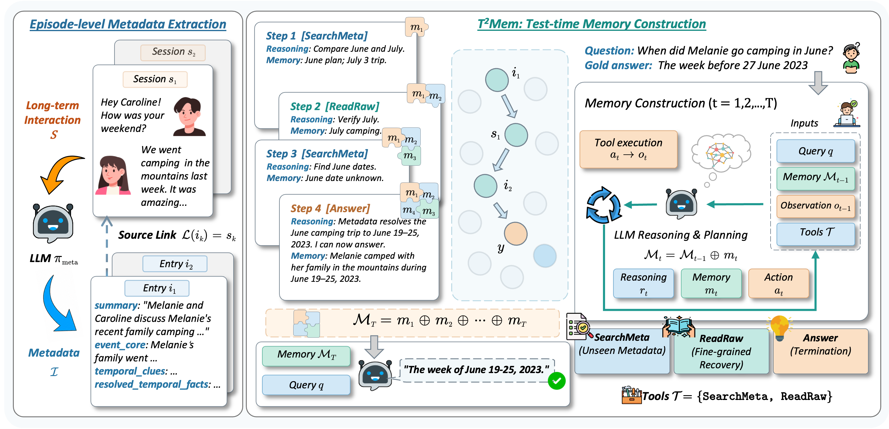

<div align="center">

<h1> Test-Time Memory Construction
</h1>

<h5 align="center">
<a href='https://arxiv.org/abs/xxxx.xxxxx'></a>
<a href='requirements.txt'></a>
<a href='LICENSE'></a>
<a href='https://github.com/snap-research/locomo'></a>
<a href='https://github.com/xiaowu0162/LongMemEval'></a>
</h5>

<h5 align="center">
Zijun Wang<sup>1*</sup>, Yifan Ji<sup>1*</sup>, Haidong Xin<sup>1</sup>, Zhenghao Liu<sup>1†</sup>, Yukun Yan<sup>2</sup>,
<br>
Zulong Chen<sup>3</sup>, Yu Gu<sup>1</sup>, Ge Yu<sup>1</sup>, Maosong Sun<sup>2</sup>
<br><br>
<sup>1</sup> Northeastern University &nbsp;&nbsp; <sup>2</sup> Tsinghua University &nbsp;&nbsp; <sup>3</sup> Alibaba Group
<br>
<sub><sup>*</sup> Equal contribution. &nbsp; <sup>†</sup> Corresponding author.</sub>
</h5>
</div>

## 📖 Introduction

T $^2$ Mem enables LLMs to reason over long interaction histories by deferring memory construction to test time. It extracts lightweight episode-level metadata offline, then adaptively retrieves and organizes metadata and raw interactions to progressively build query-specific memory as reasoning unfolds. T $^2$ Mem consistently outperforms strong baselines on LoCoMo and LongMemEval across different backbone LLMs while substantially reducing memory construction overhead.



## ⚙️ Setup

### 1. Create Python Environment

Use Python **3.10 or newer**.

```bash
git clone https://github.com/OpenBMB/T2Mem.git
cd T2Mem
python -m venv .venv
source .venv/bin/activate
python -m pip install -r requirements.txt
```

### 2. Configure APIs

```bash
cp .env.example .env
```

Edit `.env` with the endpoints, API keys, and served model names for the **LLM**, **embedding model**, and **evaluation judge**. All three use OpenAI-compatible APIs. `run.py` loads `.env` automatically.

### 3. Prepare data

Download either or both datasets and place the files in `data/`:

| Dataset | Download | Filename |
|---|---|---|
| LoCoMo | [Official data](https://github.com/snap-research/locomo/tree/main/data) | `locomo10.json` |
| LongMemEval | [Cleaned dataset](https://huggingface.co/datasets/xiaowu0162/longmemeval-cleaned) | `longmemeval_s_cleaned.json` |

```text
data/
├── locomo10.json
└── longmemeval_s_cleaned.json
```

## 🔧 Reproduction Guide

### 1. Run

Check the configuration, then run all datasets found in `data/`:

```bash
python run.py --check --temperature 0.0 --answer-max-tokens 1024
python run.py --temperature 0.0 --answer-max-tokens 1024
```

To run a single dataset, add `locomo` or `longmemeval` after `run.py`. To generate predictions without evaluation, add `--skip-eval`.

Alternatively, run the stages in order:

```bash
python run.py locomo --stage preprocess
python run.py locomo --stage index --temperature 0.0
python run.py locomo --stage retrieve
python run.py locomo --stage infer --temperature 0.0 --answer-max-tokens 1024
python run.py locomo --stage evaluate
```

Replace `locomo` with `longmemeval` for LongMemEval.

### 2. View outputs

- `outputs/`: model predictions.
- `eval-results/`: judgments and accuracy summaries.
- `data/`: processed data, indexes, and retrieval files.

## 📧 Contact

For questions, suggestions, or bug reports, please contact:

```
xinhaidong@stumail.neu.edu.cn
```
