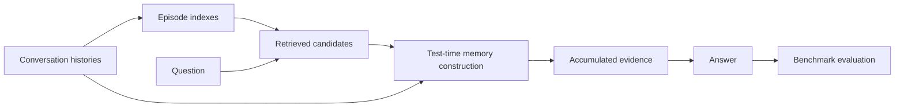

<div align="center">

# T2Mem: Test-Time Memory Construction

[](https://github.com/OpenBMB/T2Mem)
[](environment.yml)
[](LICENSE)

Experiment code for **Test-Time Memory Construction**.

[Introduction](#introduction) · [Setup](#setup) · [Reproduction](#reproduction) · [Evaluation](#evaluation) · [Structure](#structure)

</div>

<a id="introduction"></a>

## 📖 Introduction

**T2Mem** constructs query-relevant memory at inference time from long conversation histories. It first builds lightweight episode indexes. Given a question and retrieved candidate episodes, a controller iteratively reads indexes, recovers raw sessions, and accumulates evidence. A separate answer stage generates the final response from that evidence.

This repository contains the preprocessing, episode indexing, retrieval, test-time construction, and LLM-judge evaluation pipelines for **LoCoMo** and **LongMemEval**, including structured-index, summary-index, and reading-mode ablations.



<a id="setup"></a>

## ⚙️ Setup

### 1. Install

```bash
git clone https://github.com/OpenBMB/T2Mem.git
cd T2Mem

# Conda (Python 3.10)
bash scripts/setup_env.sh
conda activate t2mem
```

Alternatively, use a virtual environment with Python 3.10 or newer:

```bash
python -m venv .venv
source .venv/bin/activate
python -m pip install -r requirements.txt
```

Episode indexing, inference, and evaluation call OpenAI-compatible APIs. Retrieval supports API embeddings for structured LoCoMo indexes and local embeddings for all supported representations. Install the optional local backend when needed:

```bash
python -m pip install -r requirements-local.txt
```

Local embeddings require a sentence-transformers model and install PyTorch. The LLM stages do not load local model weights.

### 2. Configure endpoints

```bash
cp .env.example .env
# Edit .env with your endpoint URLs, served model names, and keys.
set -a
source .env
set +a
```

`.env` is ignored by Git. No credentials or remote deployment addresses are bundled. Local endpoints without authentication use the `EMPTY` key placeholder; the judges require an endpoint and an API key.

The [`.env.example`](.env.example) template documents the LLM, embedding, and judge settings separately, plus optional data paths and runner parameters. Scripts do not automatically load `.env`; run the export commands above in each new shell. Controller and answer models use `T2MEM_LLM_MODEL_NAME` by default; select different models on the same endpoint with `--controller-model-name` and `--answer-model-name`.

| Setting | Purpose |
|---|---|
| `T2MEM_LLM_BASE_URL`, `T2MEM_LLM_MODEL_NAME`, `T2MEM_LLM_API_KEY` | Episode indexing and inference |
| `T2MEM_EMBEDDING_BASE_URL`, `T2MEM_EMBEDDING_MODEL_NAME`, `T2MEM_EMBEDDING_API_KEY` | API embedding retrieval |
| `T2MEM_EMBEDDING_MODEL` | Local embedding model path or model ID |
| `JUDGE_BASE_URL`, `JUDGE_API_KEY`, `JUDGE_MODEL` | LLM-judge evaluation |

Runner overrides and supported parameter combinations are described in [docs/experiments.md](docs/experiments.md).

<a id="reproduction"></a>

## 🔧 Reproduction Guide

Run the following stages from the repository root. Runner scripts also resolve their source paths correctly when called from another directory.

### 1. Prepare benchmark data

Download the raw benchmarks from their upstream releases and place them under `data/raw/`:

- [LoCoMo](https://github.com/snap-research/locomo): `data/raw/locomo10.json`
- [LongMemEval](https://github.com/xiaowu0162/LongMemEval): `data/raw/longmemeval_s_cleaned.json`

Datasets and generated artifacts are excluded from Git. Download commands, schemas, and expected filenames are in [data/README.md](data/README.md).

```bash
bash scripts/preprocess_data.sh locomo
bash scripts/preprocess_data.sh longmemeval
```

### 2. Build episode indexes

```bash
bash scripts/run_build_wiki.sh locomo
bash scripts/run_build_wiki.sh longmemeval
```

Each session becomes an index containing its summary, event core, atomic facts, entities, temporal clues, resolved temporal facts, and ongoing threads. The source files use `wiki` to refer to these episode indexes.

### 3. Retrieve candidate episodes

```bash
# LoCoMo: OpenAI-compatible embedding API (configured in .env).
bash scripts/run_retrieval.sh locomo wiki

# LongMemEval: local embeddings (requires requirements-local.txt).
EMBED_BACKEND=local bash scripts/run_retrieval.sh longmemeval wiki
```

The default retrieval candidate count is 10; the reader initially observes 5 candidates. Set `TOP_K` on the respective runner to change either count.

### 4. Construct memory and answer

```bash
bash scripts/run_t2mem.sh locomo full
bash scripts/run_t2mem.sh longmemeval full

# Small run before launching a full experiment.
bash scripts/run_t2mem.sh locomo full --limit 5
```

The default output filenames are:

```text
outputs/locomo_structured_t2mem_full_answers.jsonl
outputs/longmemeval_structured_t2mem_full_answers.jsonl
```

Every prediction row contains query metadata, the controller trace, accumulated evidence, and the final `prediction`. Failed queries retain an `error` field and an empty prediction. Structured LoCoMo runs additionally write a `*_token_usage_summary.json`; the other entry points do not currently produce that aggregate file.

### 5. Run ablations

```bash
# Index-only reading.
bash scripts/run_t2mem.sh locomo wiki-only

# Raw-only reading: build the matching raw-session retrieval file first.
EMBED_BACKEND=local bash scripts/run_retrieval.sh locomo raw
bash scripts/run_t2mem.sh locomo raw-only

# Summary-index ablation: use matching summary retrieval.
VARIANT=summary bash scripts/run_build_wiki.sh locomo
VARIANT=summary EMBED_BACKEND=local bash scripts/run_retrieval.sh locomo wiki
VARIANT=summary bash scripts/run_t2mem.sh locomo full

# Structured LoCoMo controller-output budget ablation.
bash scripts/run_t2mem.sh locomo wiki-only --output-budget-tokens 400
```

Structured LongMemEval supports the same three reading modes. Its summary ablation follows the same three summary commands with `longmemeval`. The output-budget and reasoning-budget flags are currently implemented only by the structured LoCoMo entry point. See the [support matrix](docs/experiments.md) before combining settings.

<a id="evaluation"></a>

## 📊 Evaluation

With judge credentials configured in `.env`:

```bash
bash scripts/run_eval.sh locomo \
  outputs/locomo_structured_t2mem_full_answers.jsonl

bash scripts/run_eval.sh longmemeval \
  outputs/longmemeval_structured_t2mem_full_answers.jsonl
```

Evaluation writes per-query judgments and an accuracy summary under `eval-results/`. The LoCoMo runner converts JSONL predictions into the judge's conversation-keyed input. LoCoMo category 5 is excluded, as in the supplied experiment code. Failed prediction rows are retained as empty responses rather than silently removed.

Judge failures and invalid responses must be checked before interpreting accuracy; the judges' overall accuracy uses valid judgments. This repository does not bundle paper result tables or claim that the offline checks reproduce model accuracy. The evaluation conventions are documented in [docs/experiments.md](docs/experiments.md#evaluation-conventions).

<a id="structure"></a>

## 📁 Repository Structure

```text
T2Mem/
├── README.md
├── LICENSE                       MIT license
├── .env.example                  Endpoint and model configuration template
├── environment.yml               Conda environment
├── requirements.txt              API pipeline dependencies
├── requirements-local.txt        Optional local embedding dependencies
├── scripts/                      Preprocessing, indexing, retrieval, inference, evaluation
├── src/
│   ├── locomo/
│   │   ├── t2mem/                Controller loop and answer entry points
│   │   ├── prompt/               Indexing, controller, and answer prompts
│   │   ├── wiki/                 Preprocessing and episode indexing
│   │   ├── retrieval/            Candidate retrieval
│   │   └── utils/                Dataset reader, API client, config, index repair
│   └── longmemeval/               Same stages for LongMemEval
├── evaluation/                   Judges and LoCoMo prediction adapter
├── data/README.md                Benchmark acquisition and schemas
├── docs/experiments.md           Settings, outputs, and evaluation conventions
├── CONTRIBUTING.md              Development and commit conventions
└── tests/                        Offline integration tests
```

The benchmark implementations run as separate CLI processes and retain their dataset-specific prompts and behavior. They are not an installable shared Python package.

## 🧪 Development Checks

```bash
python -m unittest discover -s tests -v
python -m compileall -q src evaluation tests
```

Tests exercise both benchmarks, structured and summary indexing, retrieval wiring, all structured reading modes, controller actions, budget fallback, prediction conversion, evaluation, and CLI imports. A local mock API and deterministic embedding stub replace external models; no benchmark download or paid API call is required. GitHub Actions runs these checks on Python 3.10 and 3.12.

## 🙏 Acknowledgements

We thank the authors of [LoCoMo](https://github.com/snap-research/locomo) and [LongMemEval](https://github.com/xiaowu0162/LongMemEval) for their benchmarks. Repository presentation follows the research-code organization of [MetaMem](https://github.com/OpenBMB/MetaMem) and [ParamMute](https://github.com/OpenBMB/ParamMute).

## 📄 License

The code is distributed under the [MIT License](LICENSE). Benchmark data and pretrained models remain subject to their upstream terms.
